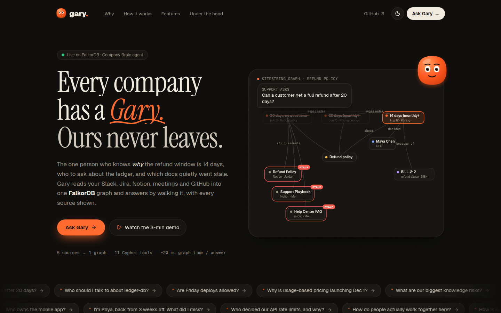
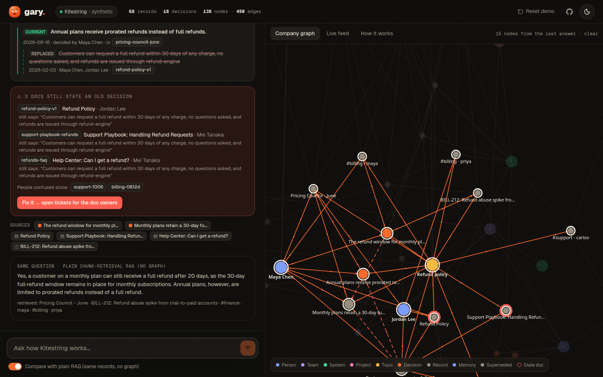
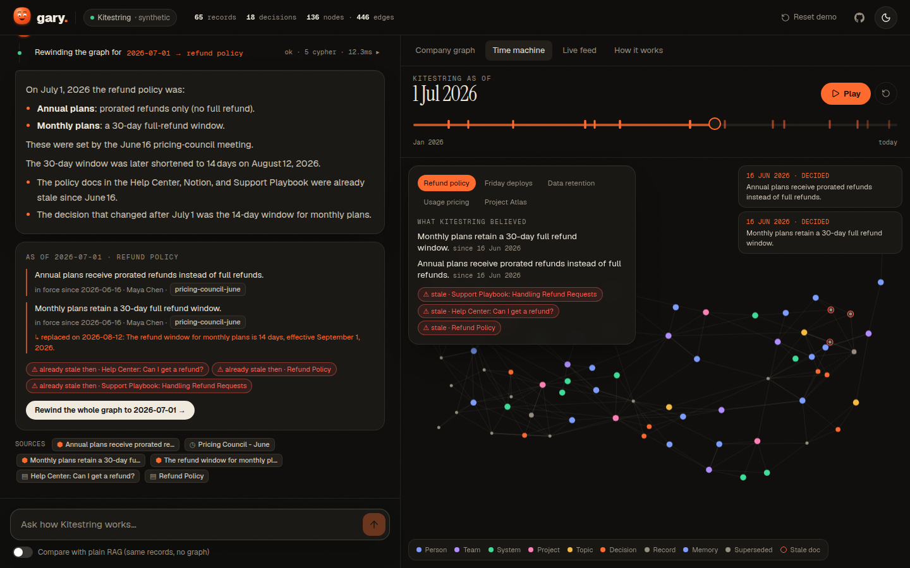
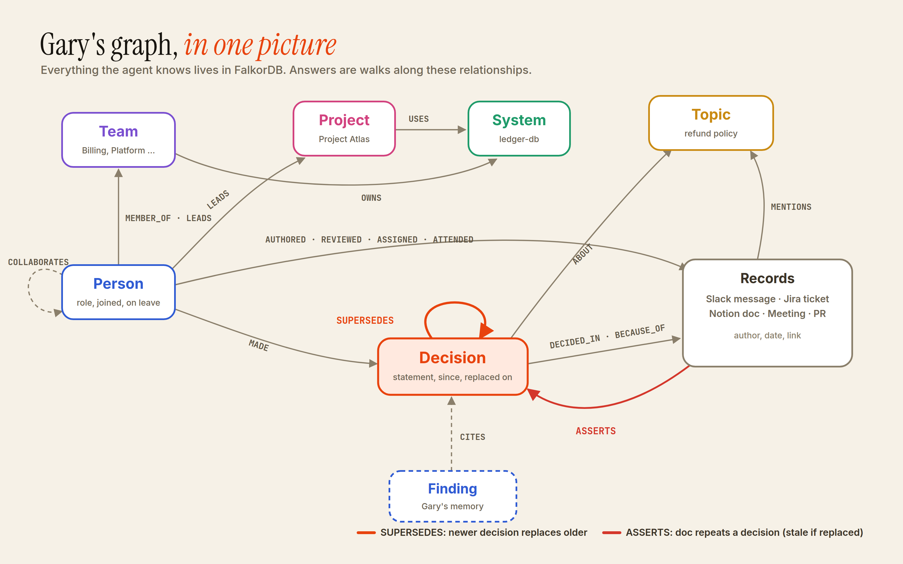

  

<h1 align="center">gary.</h1>

  <b>Every company has a Gary. Ours never leaves.</b> 
  An AI agent that actually understands how your company works, because it reads everything into a FalkorDB graph and answers by walking it.

  
  
  

  <a href="https://heygary.vercel.app"><b>Try it live</b></a> &nbsp;·&nbsp;
  <a href="https://youtu.be/x5YpXz-GukM"><b>Watch the demo</b></a> &nbsp;·&nbsp;
  <a href="docs/TECHNICAL.md"><b>Technical notes</b></a>

 

## Every company has a Gary

You know the guy. He has been at the company since the early days. Ask him why the refund window is 14 days and he will tell you the whole story in two minutes: the refund abuse in July, the Slack thread where Maya approved the change, and the old Notion page you should stop trusting. Ask him who really understands the ledger and he will say "talk to Tomasz, but do it before November, he is going on leave."

Every company has one person like this. The day Gary goes on holiday, things slow down. The day he leaves, the company simply forgets.

So I built a Gary that never leaves.

## So what is it, exactly?

Gary is an AI agent for company knowledge. It reads your Slack, Jira, Notion, meeting notes and GitHub. But instead of throwing all of that into a search index, it builds a graph in FalkorDB. People, teams, systems, projects, every record, and most importantly the **decisions** people made and which older decisions they replaced.

When you ask Gary something, it does not go looking for text that sounds similar to your question. It walks the graph. That is why it can tell you what is true right now, what used to be true, who decided it, why they decided it, and which docs are quietly lying to you.

## "Okay, but isn't this just another chatbot on top of documents?"

Fair question. My friend asked me the exact same thing, so let me explain with one example.

In the demo company, a Notion page from February says customers can get a full refund within 30 days. In June, a pricing meeting changed the rule for annual plans. In August, the CEO cut the monthly window to 14 days in a Slack thread because people were abusing refunds. Nobody updated the Notion page. Nobody updated the support playbook. Nobody updated the public help center article.

Now a support person asks: *"Can a customer get a full refund after 20 days?"*

A normal document chatbot finds the pages with the right words and says yes, 30 days. Very confident. Completely wrong.

Gary sees that the August decision replaced the June one, which replaced the February one. So it says no, it has been 14 days since August 12, Maya decided it in #billing because of the refund abuse ticket. Then it adds the part nobody asked for but everybody needs: three docs still say 30 days, here are the people who wrote them, should I open tickets for them?

The app shows both answers side by side. Same records, same language model. The only difference is the graph.

## What Gary can do

| | |
|---|---|
| **Knows what is true right now** | Every decision is linked to the one it replaced, so Gary answers with the current one and tells you what changed and when. |
| **Finds stale docs by itself** | Any doc that still states an old decision gets flagged, along with its author. |
| **Knows who actually knows** | Not the org chart. The people who wrote, reviewed and worked on something recently. Asking a question counts less than answering one. |
| **Spots risk early** | If one person holds most of the knowledge about a system and is going on leave next month, Gary tells you and suggests backups from the graph. |
| **Time machine** | Ask what the policy was on July 1, or drag a timeline and watch the whole company graph rebuild itself day by day. |
| **Catches you up** | "I'm back from three weeks off, what did I miss?" gives you only the changes in your own part of the company. |
| **Explains the real why** | Usage pricing launches on December 1 because the ledger migration moved to October 28, which moved because of the SOC2 audit freeze. Three hops, and Gary walks all of them. |
| **Stays current** | Post a new Slack message and the graph updates in milliseconds. Old decisions get replaced, and anything Gary remembered from before is marked outdated. |
| **Does the work** | Click "Fix it" and Gary opens a ticket for every stale doc, assigned to the person who wrote it. |
| **Says "I don't know"** | If something is not in the graph, Gary tells you plainly. No guessing. |
| **Works with other agents** | All the same tools are available over MCP, so Claude Desktop, Claude Code or any MCP client can use Gary as its company brain. |

## The time machine

Honestly, this one is my favourite.

Gary never deletes a decision. When something gets replaced, the old decision stays in the graph with the date it stopped being true. That small detail means you can rewind the whole company to any day.

Open the Time machine tab and press play. You will see records appear on the day they were written, people show up when they joined (Kai only appears in October), decisions turn grey the moment they are replaced, and docs turn red on the exact day they went stale. On the side, a small card shows what Kitestring believed about the refund policy at that moment, and it rewrites itself as you scrub.

You can also just ask: *"What was our refund policy on July 1?"* Gary answers with what was true that day, who had decided it, what replaced it later, and which docs were already out of date. Then one click rewinds the full graph to that date.

## Try it yourself, it takes two minutes

Open the [live demo](https://heygary.vercel.app/app) and ask these in order:

1. **Can a customer get a full refund after 20 days?** Look at the plain chatbot answer underneath, then press **Fix it**.
2. **Who should I talk to about ledger-db?** Notice the leave warning and the backups.
3. **What was our refund policy on July 1?** Then press **Rewind the whole graph**.
4. Open **Live feed**, post the preset where the CEO changes the refund policy again, then ask question 1 one more time. Look at the memory note at the top.
5. **Who owns the mobile app?** There is no mobile app. Gary will tell you so.

If someone has messed with the demo before you, press **Reset demo** at the top. It rebuilds everything from the raw data in a few seconds.

## How it works, in simple words

1. **Read everything.** Each Slack message, ticket, doc, meeting and pull request becomes a node in the graph. Whoever wrote it, reviewed it, was assigned to it or attended the meeting gets connected to it.
2. **Link it up.** Mentions of people, systems, projects and topics are matched against what the graph already knows, so every new record plugs into the right places on its own.
3. **Understand the decisions.** A language model reads each record while looking at the decisions currently in force. It writes down new decisions, which old ones they replace, why they were made, and which docs repeat them.
4. **Answer by walking the graph.** The agent can only use 12 fixed graph queries. It never writes its own database queries, so it cannot invent a connection that does not exist.
5. **Check everything.** Every source Gary cites must come back from the graph in that same turn, and every person or team it names must really exist. If the model makes something up, that answer is thrown away and rebuilt from the graph data, and the screen tells you it happened.
6. **Remember, carefully.** Each answer is saved together with the decisions it relied on. If one of those decisions changes later, the memory is flagged as outdated instead of being trusted blindly.

## The graph

These are the things Gary keeps in FalkorDB.

| Node | What it is |
|---|---|
| Person, Team | Who works here, who leads what, and when they joined or go on leave |
| System, Project, Topic | The things people work on and talk about, like ledger-db, Project Atlas or the refund policy |
| Message, Ticket, Doc, Meeting, PR | Every record from the five tools, with its author, date and link |
| Decision | A rule, plan or date someone agreed on, with the day it started and the day it was replaced |
| Finding | Gary's own memory of past answers |

And this is how they connect.

| Relationship | Meaning |
|---|---|
| MEMBER_OF, LEADS, OWNS, USES | The org chart and who owns which system or topic |
| AUTHORED, REVIEWED, ASSIGNED, ATTENDED | Who did the work on each record |
| MENTIONS, CHANGES, REFERENCES, REPLY_TO | What each record talks about, touches or points to |
| MADE, ABOUT, DECIDED_IN, BECAUSE_OF | Who made a decision, what it is about, where it was made and why |
| SUPERSEDES | A newer decision replacing an older one. This one edge is the heart of Gary |
| ASSERTS | A doc or ticket repeating a decision. When that decision is replaced, the doc is stale |
| COLLABORATES | Worked out from shared threads, tickets and meetings, used to find real teams |
| CITES | Which decisions a memory relied on, so the memory can expire |

## The graph queries behind each feature

| Feature | How the graph answers it |
|---|---|
| Decision history | Follows SUPERSEDES links up to six steps back from every decision that is still in force |
| Stale docs | Finds docs that ASSERT a decision which has since been replaced |
| Time machine | Keeps only the decisions whose start date is before the chosen day and whose replacement date is after it |
| Who knows | Weighs authored, assigned, reviewed and attended work, with older work fading over about four months |
| Risk radar | Measures how much of the knowledge about each system sits with one person, plus upcoming absences |
| Knowledge brokers | FalkorDB betweenness centrality on the collaboration graph |
| Real teams | FalkorDB label propagation, compared with the org chart |
| How is A connected to B | FalkorDB shortest path search in any direction |
| Finding things by name | FalkorDB full text indexes on names and on every record |

The exact Cypher for every one of these lives in the [technical notes](docs/TECHNICAL.md).

## Proof that the graph does the work

A fair test for any graph project is simple: take the graph away and see what breaks. With Gary, almost everything breaks.

* **Side by side, same everything.** The app runs a plain document chatbot next to Gary with the same records, the same language model and even FalkorDB's own full text index, just without the relationships. Ask "Can a customer get a full refund after 20 days?" and the plain chatbot says yes, 30 days. Gary says no, 14 days, because it follows the SUPERSEDES links. You can switch this comparison on in the app and see it yourself.
* **Every answer shows its queries.** Each step Gary takes lists the exact Cypher it ran, how many rows came back and how long it took. Most answers need several traversals and around 20 milliseconds of graph time.
* **The features only exist because of relationships.** Current versus replaced decisions, stale documents, who knows what, single points of knowledge, catching one person up, the time machine, multi step "why" answers and memory that expires are all walks through the graph. None of them can come from text similarity alone.
* **Algorithms run inside the database.** Shortest path, betweenness centrality and label propagation run as FalkorDB procedures inside the same queries as the rest of the logic.
* **The model cannot invent connections.** The agent only uses twelve fixed graph queries, and names are checked against the graph before and after the model writes an answer.

## Run it on your own machine

1. You need Docker, Node 20 or newer, pnpm, and a free Groq API key. Any OpenAI compatible endpoint works, even a local Ollama.
2. Clone this repo and start FalkorDB with the included Docker Compose file. You also get the FalkorDB Browser on port 3000, if you want to poke at the graph yourself.
3. Copy the example env file to a new file called .env.local and put your API key in it.
4. Install the packages, run the seed script to build the demo company graph, and start the dev server.
5. Open localhost on port 3100 for the landing page, and the /app page for Gary himself.

The exact commands, all environment variables, and how to plug Gary into Claude Desktop over MCP are in the [technical notes](docs/TECHNICAL.md).

## The company inside the demo

Kitestring is a made up 21 person startup that sells subscription billing software. Its 65 records across five tools are written so that the right answer always depends on how things connect. The refund policy changes twice. The ledger migration gets pushed back by a SOC2 audit. The only engineer who has run the migration checks is going on parental leave right in the middle of the cutover. A Friday deploy freeze gets lifted. Invoices get an exception to the data deletion rule.

Every person, message and ticket is synthetic. No private or scraped data is used anywhere. The decision extraction was run with an open model and then reviewed by hand, and the live feed always runs the model fresh against the current graph.

## Built with

FalkorDB for the graph, Cypher, graph algorithms and full text search, hosted on FalkorDB Cloud. Next.js on Vercel for the app. Open models served by Groq (gpt oss 120b, with smaller models as automatic fallbacks). Motion, anime.js and Lenis for the animations, with a few components from Magic UI and Animate UI. The Model Context Protocol SDK for the MCP server.

## For the Graph Hacks judges

**Tracks entered.** Track 03 Company Brain is the main one. Gary also fits Track 01, because it acts on connected data with graph algorithms as tools and is exposed over MCP, and Track 02, because its memory persists across sessions and expires when the facts change.

**Everything the rules ask for.** Public repo, this README with setup steps and the graph model, the exact Cypher in the [technical notes](docs/TECHNICAL.md), a [demo video](https://youtu.be/x5YpXz-GukM), and a [live deployment](https://heygary.vercel.app).

**About AI help.** I built this during the hackathon with Claude Code as my pair programmer. The idea, the demo company and its stories, the design decisions and all the testing were done together, and it helped me write a lot of the code quickly. The graph model and the queries are documented so you can check every claim yourself.

## What comes next

Real connectors with webhooks instead of exported files, permissions that travel with every record so people only see what they are allowed to see, and one graph per company so a single FalkorDB instance can hold many teams.

 

  Built for the Graph Hacks hackathon by Hassaan ❤️ 
  Thanks to WeMakeDevs and FalkorDB for organising it.

